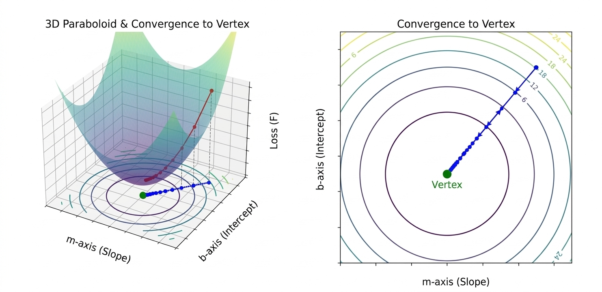
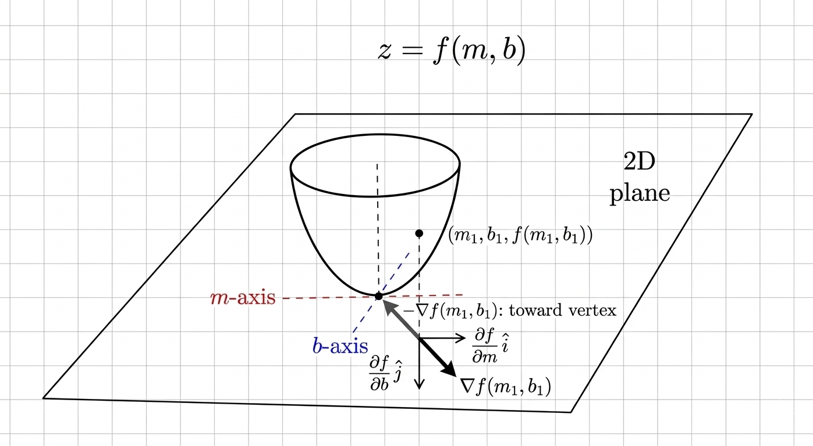

# Gradient Descent & 2D Gradient Application (z = f(m, b))

## Sum of Squared Residuals

  

A 3D paraboloid error function with a leading coefficient > 0 $\implies$ its partial derivatives = 0 $\Leftrightarrow$ its coordinate = slope & intercept of the linear regression.

Linear regression: $l(x)=mx+b$

**SSR function (Sum of Squared Residuals):**

$$
f(m, b) = \sum ((mx_i + b)-y_i)^2
$$

**SSR Partial Derivatives:**

$$
\frac{\partial f}{\partial m} = \sum 2x_i((mx_i + b) - y_i) \qquad \frac{\partial f}{\partial b} = \sum 2((mx_i + b) - y_i)
$$

**2D Gradient of SSR (using learning rate $\eta$):**

  

$\nabla f$ is a vector field (set of continuous vector outputs)

$$
\nabla f(m, b) = \frac{\partial f}{\partial m} \ \hat{i} + \frac{\partial f}{\partial b} \ \hat{j}
$$

**2D Contour Vector Projection:**

$$
\vec{x}_n = m_n \hat{i} + b_n \hat{j} \quad \text{(on mb-plane)}
$$

Movement of $\vec x$ is toward the vertex on the mb-plane (with a low $\eta$).

**To find Vertex Coordinate:**

$$
\frac{\partial f}{\partial m} = 0 \ \text{ and } \ \frac{\partial f}{\partial b} = 0 \qquad \Leftrightarrow \qquad \|\nabla f(m_\text{vertex}, b_\text{vertex})\| = 0
$$

**Step Size Algorithm:**

$$
\vec{x}_{n+1} = \vec{x}_n - \eta \ \nabla f(m_n, b_n) \qquad \Leftrightarrow \qquad m_{n+1} = m_n - \eta \ \left. \frac{\partial f}{\partial m} \right |_{(m, b) = (m_n, b_n)} \ \text{ and } \quad b_{n+1} = b_n - \eta \ \left. \frac{\partial f}{\partial b} \right |_{(m, b) = (m_n, b_n)}
$$

$\lim_{n \to \infty} m_n = m_{\text{vertex}}$ and $\lim_{n \to \infty} b_n = b_{\text{vertex}}$, thus $\uparrow n \implies \downarrow \|\nabla f(m_\text{n}, b_\text{n})\|$

## Project Overview
- (Implementation): Integrated partial differentiation to upgrade a Java-based linear regression tool for highway traffic modeling.
- (Tools Extension): Self-studied Vector Calculus to re-analyze the optimization trajectory via 2D Gradient Field (∇f).

# Convergence & Limitations
- The algorithm requires a sufficiently small learning rate ($\eta$) to ensure convergence. On a paraboloid surface, convergence slows significantly near the local minimum as the gradient magnitude approaches zero ($\|\nabla f\| \approx 0$). This reflects the inherent asymptotic convergence behavior of standard gradient descent, where step sizes naturally shrink near the optimum.
